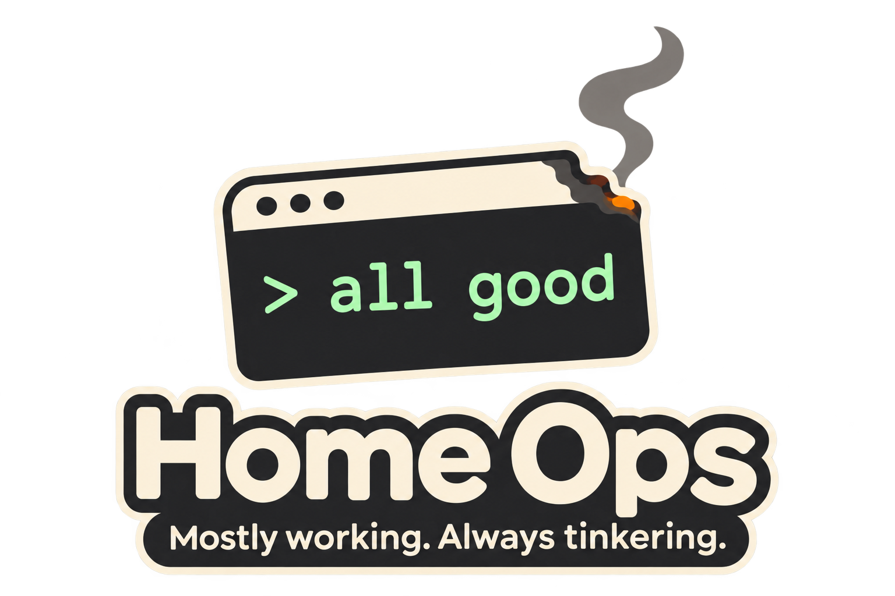

# home-ops

Homelab Kubernetes using Flux.



## 📖 Project Documentation

- **[AGENTS.md](AGENTS.md)**: Comprehensive project specification and AI agent instructions.
- **[Documentation site](https://damacus.github.io/home-ops/)**: operations, provisioning, application guides and Helm chart references.
- **[Helm chart catalogue](docs/helm-charts.md)**: chart sources, pinned versions and local configuration.
- Use application READMEs for operating procedures and `task --list` for automation.

## 🚀 Getting Started

1. Install the pinned command-line tools:
   ```bash
   mise install
   ```
2. Install the locked Ruby gems with `bundle install`. See the documentation
   site's setup instructions for frontend dependencies.
3. Read the relevant application README for deployment and maintenance procedures.
4. List the repository automation:
   ```bash
   task --list
   ```

## 🤝 Credits

Inspiration from the amazing community over at [Home Operations](https://discord.com/invite/home-operations) & [kubesearch](https://kubesearch.dev/)
